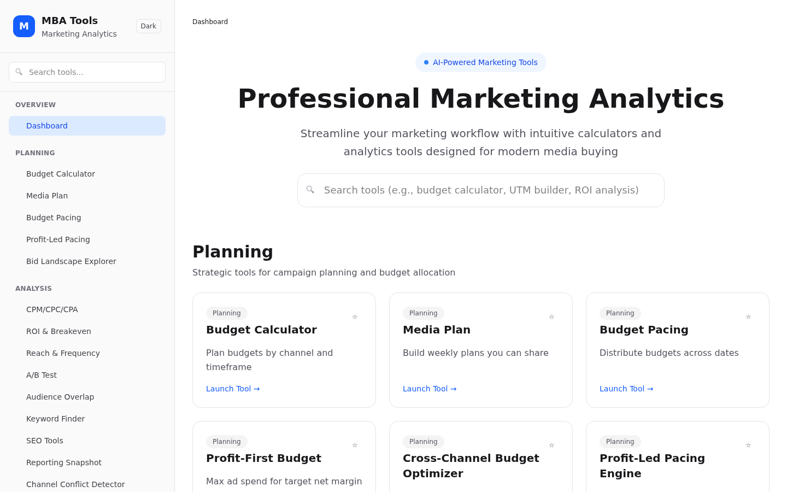
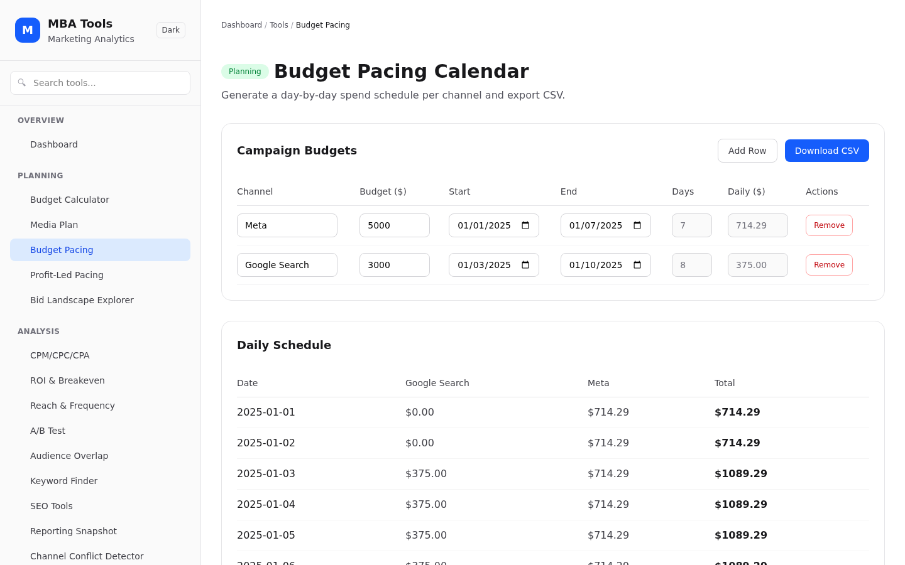

# MBA Tools

A web toolkit for media buyers and performance marketers: budget planning, ROI maths, UTM building, pixel checks, creative QA and more, in one dashboard. Built with Next.js, React and Tailwind CSS.



## What is inside

About 47 tools grouped by job:

| Category | Tools |
| --- | --- |
| Planning | Budget Calculator, Media Plan, Budget Pacing, Profit-First Budget, Profit-Led Pacing, Cross-Channel Budget Optimizer, Bid Landscape Explorer |
| Analysis | CPM/CPC/CPA, ROI and Breakeven, Break-even ROAS, Reach and Frequency, A/B Test Calculator, Audience Overlap, Holdout Group Calculator, True CAC with Cohort Retention, Funnel Analyzer, Landing Analyzer, Performance Grader, SEO Tools, Keyword Finder and more |
| Operations | UTM Builder, Bulk UTM, Pixel Checker, Pixel Helper, Redirect Tester, Policy Checker, Performance Digest, Cash Flow Forecast for Ad Spend and more |
| Creative | Creative QA, Creative Specs, Creative Tracker, Creative Saturation Heatmap, Copywriting Helper, Ad Forms, AI Assistant, AI Media Brief Generator |
| Strategy | Marketing Strategy Advanced Planner |



## How it works

- Most calculators run entirely in your browser. Favourites and recently used tools are saved in your browser's local storage.
- Three tools call server routes: Pixel Checker, Landing Analyzer and Redirect Tester fetch the page you enter. They only accept public `http` and `https` URLs. Localhost, private network addresses, link-local and cloud metadata addresses are rejected, redirects are re-checked on every hop, and responses are capped at 2 MB with a 10 second timeout.
- The AI Assistant and Copywriting Helper call Google Gemini or OpenRouter through server routes and need your own API key. Without a key they return an error instead of a result.

## Getting started

Requires Node.js 20 or newer.

```bash
npm ci
npm run dev
```

Open <http://localhost:3000>.

Optional environment variables (create `.env.local`, which is git-ignored):

```bash
GEMINI_API_KEY=your-google-ai-studio-key
OPENROUTER_API_KEY=your-openrouter-key
```

Production build:

```bash
npm run build
npm start
```

## Known limits

- The server routes block internal addresses at connection time (the checked DNS result is the one connected to) and on every redirect. Defence in depth still applies: if you deploy this publicly, keep the server off your internal network. HTTP proxies and non-Node runtimes (edge) are not covered by this guard.
- There is no authentication or rate limiting. Do not expose the AI routes publicly with a paid API key without adding both.
- Tool results are estimates from the numbers you enter. Check them before spending real budget.
- `npm run lint` still reports some `any` type errors in older tool pages.

## Project layout

```
src/app/tools/      one folder per tool
src/app/api/        server routes (AI providers, page checks, redirect tracing)
src/lib/safeFetch.ts  URL validation used by the page-checking routes
src/components/     sidebar, header, shared UI
```

## Contributing

Issues and pull requests are welcome. Please run `npm run build` before opening a pull request.

## License
The source code is licensed under the MIT License (see [LICENSE](LICENSE)). The licence covers the code only. Photos and other images (including images from Unsplash), brand names, logos and business text (for example restaurant or visa-agency details) are not covered: they keep their own terms or are reserved by their owners.
